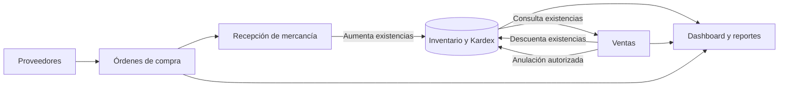

# MOAL — Sistema de Gestión Empresarial


ERP académico desarrollado para MOAL en el proyecto de Software de Gestión Empresarial de COTECNOVA. Centraliza la gestión de productos, inventario, compras, ventas, clientes, proveedores, usuarios y operaciones de la empresa.

## Tabla de contenido

- [MOAL — Sistema de Gestión Empresarial](#moal--sistema-de-gestión-empresarial)
  - [Tabla de contenido](#tabla-de-contenido)
  - [¿Qué es y para qué sirve?](#qué-es-y-para-qué-sirve)
  - [Funcionalidades](#funcionalidades)
  - [Tecnologías](#tecnologías)
  - [Requisitos previos](#requisitos-previos)
  - [Instalación paso a paso](#instalación-paso-a-paso)
    - [1. Clonar el repositorio](#1-clonar-el-repositorio)
    - [2. Crear el entorno e instalar dependencias](#2-crear-el-entorno-e-instalar-dependencias)
    - [3. Configurar la conexión local](#3-configurar-la-conexión-local)
    - [4. Iniciar los contenedores](#4-iniciar-los-contenedores)
    - [5. Preparar Laravel y la base de datos](#5-preparar-laravel-y-la-base-de-datos)
    - [6. Instalar y compilar el frontend](#6-instalar-y-compilar-el-frontend)
    - [7. Abrir la aplicación](#7-abrir-la-aplicación)
  - [Usuarios de prueba](#usuarios-de-prueba)
  - [Uso diario](#uso-diario)
  - [Comandos útiles](#comandos-útiles)
  - [Correo y notificaciones](#correo-y-notificaciones)
  - [API REST y Postman](#api-rest-y-postman)
  - [Importación y exportación](#importación-y-exportación)
  - [Estructura del proyecto](#estructura-del-proyecto)
  - [Conceptos clave de la arquitectura](#conceptos-clave-de-la-arquitectura)
  - [Pruebas automatizadas](#pruebas-automatizadas)
  - [Producción](#producción)
  - [Solución de problemas](#solución-de-problemas)

## ¿Qué es y para qué sirve?

Un ERP integra procesos de una empresa en un solo sistema. En este proyecto, las compras recibidas aumentan el inventario, las ventas descuentan existencias y los movimientos quedan registrados en el Kardex.



## Funcionalidades

| Módulo | Funcionalidad |
|---|---|
| Productos y categorías | Administración del catálogo, estados activo e inactivo, búsqueda y papelera |
| Clientes y proveedores | Administración de contactos comerciales |
| Ventas | Registro de ventas con productos, cantidades, método de pago e impuestos |
| Anulación de ventas | Devolución de existencias y conservación del registro histórico |
| Compras | Órdenes de compra y recepción de mercancía para actualizar inventario |
| Kardex | Consulta de entradas, salidas, saldos y ajustes con motivo |
| PDF | Descarga de documentos de ventas, compras y movimientos de inventario |
| Dashboard | Indicadores, ventas recientes, productos más vendidos y alertas de stock bajo |
| Auditoría | Consulta de acciones por módulo, usuario, evento y fecha |
| Usuarios y roles | Administración de cuentas y permisos según el rol |
| Identidad corporativa | Configuración del nombre, logo y color de marca de la empresa |
| Notificaciones | Avisos dentro del sistema y por correo sobre eventos operativos |
| API REST | Acceso autenticado a productos y ventas mediante tokens |
| Excel | Importación y exportación de información con permisos |

## Tecnologías

| Herramienta | Uso |
|---|---|
| Laravel 13 | Rutas, controladores, modelos, validaciones y migraciones |
| PHP 8.5 | Lenguaje del servidor en el contenedor Sail |
| MySQL 8.4 | Base de datos |
| Laravel Sail | Entorno de desarrollo con Docker |
| Laravel Breeze | Autenticación y perfil |
| Laravel Sanctum | Tokens para la API |
| Spatie Laravel Permission | Roles y permisos |
| Spatie Activitylog | Registro de auditoría |
| Laravel Excel | Importación y exportación de hojas de cálculo |
| DomPDF | Generación de documentos PDF |
| Blade, Tailwind CSS y Alpine.js | Interfaz web |
| Vite y npm | Compilación de recursos frontend |
| PHPUnit y Pint | Pruebas y formato del código |
| Mailpit | Recepción local de correos de prueba |

## Requisitos previos

1. Docker Desktop con Docker Compose.
2. En Windows, WSL 2 con la integración de Ubuntu habilitada en Docker Desktop.
3. Git instalado en Ubuntu.
4. Visual Studio Code con la extensión WSL.

> Se recomienda clonar el repositorio dentro del sistema de archivos de Ubuntu, por ejemplo `~/proyecto/sge`, y evitar `/mnt/c`.

## Instalación paso a paso

Todos los comandos se ejecutan en la terminal de Ubuntu o WSL.

### 1. Clonar el repositorio

```bash
mkdir -p ~/proyecto
cd ~/proyecto
git clone https://github.com/monialeja1011/Software-de-Gestion-Empresarial-2026.git sge
cd sge
```

### 2. Crear el entorno e instalar dependencias

```bash
cp .env.example .env

docker run --rm \
  -u "$(id -u):$(id -g)" \
  -v "$(pwd):/var/www/html" \
  -w /var/www/html \
  laravelsail/php85-composer:latest \
  composer install
```

El contenedor temporal instala Composer y las extensiones requeridas sin depender del PHP instalado en Ubuntu.

### 3. Configurar la conexión local

El archivo `.env.example` está preparado para Sail. Comprueba que las variables locales tengan estos valores:

```env
APP_URL=http://localhost
DB_CONNECTION=mysql
DB_HOST=mysql
DB_PORT=3306
DB_DATABASE=laravel
DB_USERNAME=sail
DB_PASSWORD=password
MAIL_MAILER=smtp
MAIL_HOST=mailpit
MAIL_PORT=1025
QUEUE_CONNECTION=database
```

No compartas ni subas el archivo `.env`.

### 4. Iniciar los contenedores

```bash
./vendor/bin/sail up -d
./vendor/bin/sail ps
```

La primera vez Docker puede tardar varios minutos en preparar los contenedores.

### 5. Preparar Laravel y la base de datos

```bash
./vendor/bin/sail artisan key:generate
./vendor/bin/sail artisan migrate --seed
./vendor/bin/sail artisan storage:link
```

`migrate --seed` crea las tablas y ejecuta los seeders del proyecto. Si ya tienes información en tu base de datos, utiliza `migrate` sin `--seed`.

### 6. Instalar y compilar el frontend

```bash
./vendor/bin/sail npm install
./vendor/bin/sail npm run build
```

### 7. Abrir la aplicación

Visita <http://localhost>. Mailpit está disponible en <http://localhost:8025>.

## Usuarios de prueba

Las cuentas iniciales se crean mediante los seeders de `database/seeders`. Consulta `DatabaseSeeder.php` para ver las cuentas y contraseñas configuradas en tu copia del proyecto. Cambia las contraseñas iniciales antes de usar el sistema fuera del entorno local.

Los roles del proyecto incluyen:

| Rol | Acceso general |
|---|---|
| `superadmin` | Administración completa, incluidos los usuarios |
| `admin` | Administración de los módulos permitidos |
| `vendedor` | Productos, clientes y ventas según sus permisos |
| `almacenista` | Inventario, proveedores y compras según sus permisos |

Un usuario con más de un rol selecciona el rol activo para cada sesión.

## Uso diario

```bash
cd ~/proyecto/sge
./vendor/bin/sail up -d
./vendor/bin/sail ps
```

Para detener los contenedores sin borrar los datos:

```bash
./vendor/bin/sail stop
```

Durante el desarrollo frontend puedes iniciar Vite:

```bash
./vendor/bin/sail npm run dev
```

## Comandos útiles

| Comando | Función |
|---|---|
| `./vendor/bin/sail artisan migrate` | Ejecuta migraciones pendientes |
| `./vendor/bin/sail artisan migrate:status` | Consulta el estado de las migraciones |
| `./vendor/bin/sail artisan db:seed` | Ejecuta los seeders |
| `./vendor/bin/sail artisan route:list` | Lista las rutas |
| `./vendor/bin/sail artisan optimize:clear` | Limpia las cachés de Laravel |
| `./vendor/bin/sail artisan permission:cache-reset` | Limpia la caché de permisos |
| `./vendor/bin/sail artisan queue:work --tries=3` | Procesa trabajos en cola |
| `./vendor/bin/sail artisan schedule:work` | Ejecuta el planificador durante desarrollo |
| `./vendor/bin/sail artisan erp:resumen-diario` | Encola el resumen diario |
| `./vendor/bin/sail artisan kardex:inicializar` | Registra saldos iniciales en el Kardex |
| `./vendor/bin/sail test` | Ejecuta las pruebas automatizadas |
| `./vendor/bin/sail pint --test` | Comprueba el formato del código |

## Correo y notificaciones

En el entorno local, los correos se envían a Mailpit y no a destinatarios reales. Abre <http://localhost:8025> para revisarlos.

Las notificaciones en cola requieren un worker activo:

```bash
./vendor/bin/sail artisan queue:work --tries=3
```

Para ejecutar el planificador localmente:

```bash
./vendor/bin/sail artisan schedule:work
```

## API REST y Postman

La colección de Postman está en `docs/api/SGE.postman_collection.json`.

| Método | Ruta | Función |
|---|---|---|
| POST | `/api/v1/login` | Inicia sesión y devuelve un token |
| POST | `/api/v1/logout` | Revoca el token actual |
| GET | `/api/v1/me` | Consulta el usuario autenticado |
| GET | `/api/v1/products` | Lista productos |
| GET | `/api/v1/products/{product}` | Consulta un producto |
| POST | `/api/v1/sales` | Registra una venta |
| GET | `/api/v1/sales/{sale}` | Consulta una venta |

Las rutas protegidas requieren autenticación Bearer:

```http
Authorization: Bearer TU_TOKEN
Accept: application/json
```

Completa las variables de la colección con la URL local y los identificadores existentes en tu base de datos.

## Importación y exportación

Los módulos de importación y exportación están protegidos por permisos. La colección y las rutas del proyecto permiten consultar qué operaciones están disponibles para cada usuario.

## Estructura del proyecto

```text
sge/
├── app/
│   ├── Console/Commands/
│   ├── Events/
│   ├── Exports/
│   ├── Http/Controllers/
│   ├── Http/Requests/
│   ├── Imports/
│   ├── Listeners/
│   ├── Models/
│   ├── Notifications/
│   └── Services/
├── database/
│   ├── factories/
│   ├── migrations/
│   └── seeders/
├── docs/api/
├── resources/
│   ├── css/
│   ├── js/
│   └── views/
├── routes/
├── tests/
├── compose.yaml
└── .github/workflows/
```

## Conceptos clave de la arquitectura

- **Servicios:** las reglas de negocio de ventas, compras e inventario se organizan en servicios de Laravel.
- **Transacciones:** las operaciones relacionadas se confirman juntas para evitar guardar ventas, compras o movimientos parcialmente.
- **Kardex:** cada entrada, salida o ajuste registra producto, concepto, saldo y usuario asociado.
- **Permisos:** el servidor comprueba roles y permisos para autorizar rutas y acciones.
- **Auditoría:** los eventos quedan disponibles para su consulta en el módulo de auditoría.
- **Identidad corporativa:** los datos de la empresa se utilizan en la interfaz y en documentos PDF.
- **Eliminación de cuentas:** solo el superadmin puede eliminar cuentas ajenas y no puede eliminar su propia cuenta.

## Pruebas automatizadas

Ejecuta la suite completa:

```bash
./vendor/bin/sail artisan test
```

Comprueba el estilo:

```bash
./vendor/bin/sail pint --test
```

Aplica el formato:

```bash
./vendor/bin/sail pint
```

El flujo `.github/workflows/pruebas.yml` automatiza las pruebas y la revisión del formato en GitHub Actions.

## Producción

`.env.production.example` sirve como plantilla para preparar una instalación en un servidor. El proveedor de alojamiento proporciona las credenciales de base de datos y SMTP. Genera la clave de aplicación en el servidor y configura `APP_ENV=production`, `APP_DEBUG=false` y una URL HTTPS.

No publiques `.env`, claves, contraseñas ni tokens en el repositorio.

## Solución de problemas

| Problema | Qué revisar |
|---|---|
| Sail dice que Docker no está activo | Abre Docker Desktop y habilita la integración de WSL con Ubuntu |
| No aparece `vendor/bin/sail` | Instala las dependencias PHP desde el paso 2 |
| Error de conexión a MySQL | Confirma que los contenedores estén activos y que `DB_HOST=mysql` |
| Falta el manifiesto de Vite | Ejecuta `./vendor/bin/sail npm run build` |
| No aparecen correos | Revisa `MAIL_HOST=mailpit`, el puerto `1025` y Mailpit en <http://localhost:8025> |
| Fallan trabajos de cola | Inicia `./vendor/bin/sail artisan queue:work --tries=3` |
| Permiso denegado en Docker desde WSL | Comprueba la integración de Docker Desktop con tu distribución Ubuntu |

<p align="center">
  Proyecto académico · Software de Gestión Empresarial · COTECNOVA 2026
</p>