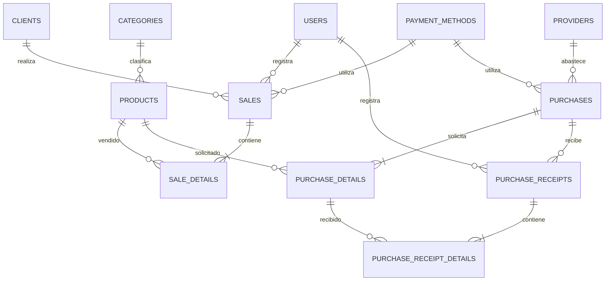

# Sistema de Gestión Empresarial (SGE)

## Información del proyecto

| Dato | Descripción |
| --- | --- |
| Nombre | Sistema de Gestión Empresarial (SGE) |
| Tipo | Aplicación web académica |
| Propósito | Administrar inventario, ventas, compras, clientes, proveedores y usuarios de una empresa comercial |
| Moneda | Pesos colombianos (COP) |
| Base de datos | MySQL |
| Estado | Aplicación funcional en entorno local con Docker y Laravel Sail |
| Repositorio | [Software de Gestión Empresarial 2026](https://github.com/monialeja1011/Software-de-Gestion-Empresarial-2026) |

## Resumen ejecutivo

El Sistema de Gestión Empresarial centraliza las operaciones de una empresa comercial. Permite administrar productos, categorías, clientes, proveedores, ventas, órdenes de compra, recepciones de mercancía, medios de pago y usuarios.

El sistema integra las operaciones comerciales con el inventario. Al registrar una venta, descuenta las unidades vendidas. Al crear una orden de compra, no modifica las existencias; estas aumentan solo cuando se registra la recepción de la mercancía. Las recepciones pueden ser parciales, conservan sus observaciones y rechazan cantidades superiores a las unidades pendientes.

La aplicación también incorpora control de acceso por roles y permisos, cálculo de IVA por producto, documentos PDF internos y un dashboard con indicadores operativos.

El catálogo de demostración contempla categorías como tecnología, aseo y cuidado personal, productos para el hogar, alimentos y bebidas.

> Los PDF generados son documentos internos del sistema. La aplicación no está integrada con la DIAN y no genera facturas electrónicas autorizadas.

## Objetivos

### Objetivo general

Desarrollar una aplicación web para administrar operaciones comerciales y mantener el control de inventario, las ventas, las compras y el acceso de los usuarios según sus funciones.

### Objetivos específicos

- Administrar productos, categorías, clientes y proveedores.
- Consultar y actualizar las existencias de los productos.
- Registrar ventas con sus productos, cantidades, impuestos y medios de pago.
- Crear órdenes de compra sin registrar anticipadamente mercancía en el inventario.
- Registrar recepciones completas o parciales de órdenes de compra.
- Impedir ventas sin existencias suficientes y recepciones por encima de las cantidades pendientes.
- Gestionar usuarios, roles y permisos.
- Consultar indicadores de actividad desde el dashboard.
- Conservar el historial relacionado con productos y categorías eliminados lógicamente.
- Generar documentos PDF internos para ventas y órdenes de compra.

## Tecnologías utilizadas

| Tecnología | Uso |
| --- | --- |
| Laravel 13 | Framework de la aplicación |
| PHP 8.3 o superior | Lenguaje del servidor |
| MySQL 8 | Base de datos relacional |
| Docker y Laravel Sail | Entorno local de desarrollo |
| Blade | Plantillas HTML del servidor |
| Tailwind CSS | Estilos de la interfaz |
| Alpine.js | Interacciones en las vistas |
| Vite | Compilación de recursos |
| Spatie Laravel Permission | Administración de roles y permisos |
| DomPDF | Generación de documentos PDF |

## Análisis del negocio

### Situación que atiende el sistema

Una empresa comercial necesita mantener conectadas sus operaciones de abastecimiento, inventario y venta. Cuando las órdenes de compra, las recepciones y las ventas se registran por separado, resulta difícil conocer las existencias disponibles, identificar pedidos que todavía no llegan y consultar qué productos tienen mayor movimiento.

El SGE centraliza esta información. Las operaciones quedan relacionadas con sus responsables, productos, cantidades, fechas, estados y valores. De esta manera, se conserva el historial comercial y se puede consultar cómo se relacionan las compras, las recepciones y las ventas.

### Actores del sistema

| Actor | Responsabilidad |
| --- | --- |
| Superadministrador | Administrar el sistema y gestionar roles y permisos. |
| Administrador | Consultar y gestionar las operaciones habilitadas para su rol. |
| Vendedor | Consultar productos y clientes autorizados, registrar ventas y consultar las operaciones permitidas. |
| Almacenista | Consultar productos, crear órdenes de compra y registrar la llegada total o parcial de mercancía. |
| Cliente | Persona o entidad asociada a una venta. |
| Proveedor | Persona o entidad asociada al abastecimiento y a las órdenes de compra. |

El acceso efectivo depende de los permisos asignados y del rol activo seleccionado para la sesión. La interfaz puede ocultar las acciones que el usuario no puede realizar, pero las rutas también comprueban la autorización en el servidor.

### Alcance funcional

El alcance implementado comprende los módulos de productos e inventario, categorías, clientes, proveedores, ventas, compras, recepciones, medios de pago, usuarios, roles, permisos y dashboard.

Los documentos PDF representan comprobantes internos. No sustituyen documentos tributarios autorizados ni acreditan una integración con la DIAN.

## Módulos funcionales

### Dashboard

Presenta un resumen de actividad que incluye:

- Valor de las ventas del mes.
- Valor de las compras del mes.
- Cantidad de clientes activos.
- Cantidad de productos activos.
- Últimas ventas.
- Productos con existencias bajas.
- Productos más vendidos.

### Productos e inventario

Permite crear, consultar y editar productos, asignarlos a categorías, registrar costos, márgenes, precios públicos y tarifas de IVA. Los listados permiten buscar y filtrar productos.

Cada producto mantiene su propia tarifa de IVA. Al recibir mercancía, el sistema actualiza el costo del producto y calcula nuevamente el precio público según el margen configurado y la tarifa de IVA del producto.

Los productos pueden desactivarse o eliminarse lógicamente. Esto permite conservar las relaciones históricas requeridas por ventas y compras anteriores.

### Categorías

Permite organizar los productos por tipo. Las categorías pueden consultarse, buscarse y eliminarse lógicamente, preservando la información histórica necesaria.

### Clientes y proveedores

El sistema mantiene los datos de clientes asociados a las ventas y de proveedores asociados a las órdenes de compra. Los datos de contacto se utilizan para identificar a las partes de cada operación.

### Ventas

Permite seleccionar cliente, medio de pago, fecha y productos. Antes de registrar una operación, comprueba las cantidades y las existencias disponibles. La venta incluye un encabezado y sus líneas de detalle.

Al confirmar la venta, se descuenta del inventario la cantidad vendida. Las ventas usan consecutivos con formato `CV-00001`. El usuario puede consultar el detalle, descargar un comprobante interno en PDF y anular la operación. Al anular una venta, se conserva el historial y se devuelve el stock.

### Compras y órdenes de compra

Permite registrar proveedor, fecha de la orden, productos solicitados, cantidades, costos cotizados, medio de pago, plazo de pago y fecha estimada de llegada. También permite consultar el estado de la orden y guardar observaciones.

Crear una orden no aumenta el inventario. El stock se actualiza únicamente con las unidades recibidas. El sistema permite registrar recepciones parciales y conserva las cantidades pendientes para entregas posteriores. No permite recibir más unidades de las que faltan en la orden.

Las órdenes usan consecutivos con formato `OC-000001`. El sistema puede generar un PDF interno de la orden.

### Recepciones de compra

Cada recepción queda asociada a una orden y registra quién la recibió, cuándo se registró, las cantidades por producto y las observaciones correspondientes.

Una recepción parcial aumenta las existencias solo por las unidades ingresadas en esa entrega. Las unidades aún pendientes no se consideran disponibles hasta que se reciba otra entrega.

### Usuarios, roles y permisos

La aplicación utiliza Spatie Laravel Permission para asignar permisos a los roles y proteger rutas y acciones. Una cuenta con varios roles puede seleccionar el rol activo para la sesión. Las autorizaciones se comprueban en el servidor, además de controlar qué acciones muestra la interfaz.

## Procesos principales

### Abastecimiento y recepción

1. Un usuario autorizado selecciona un proveedor y registra la fecha de la orden, las condiciones de pago, los productos, las cantidades y los costos cotizados.
2. El sistema guarda la orden y sus detalles, asignándole un consecutivo `OC-000001`.
3. La creación de la orden no modifica las existencias.
4. Cuando llega la mercancía, el almacenista registra las cantidades recibidas por producto.
5. El sistema compara cada cantidad recibida con las unidades pendientes y rechaza cualquier exceso.
6. La recepción puede ser parcial. Las cantidades pendientes se conservan en la orden.
7. El inventario aumenta únicamente por las unidades registradas en la recepción.
8. El sistema conserva la fecha, el usuario y las observaciones de la recepción y actualiza el estado de la orden.

### Venta y actualización del inventario

1. El usuario autorizado selecciona el cliente, el medio de pago y los productos.
2. El sistema consulta el precio público y el IVA configurado para cada producto.
3. La aplicación valida las cantidades y las existencias disponibles.
4. La venta y sus detalles se registran dentro de una transacción de base de datos.
5. Al confirmarse la operación, el sistema descuenta del inventario las unidades vendidas.
6. La venta recibe un consecutivo `CV-00001` y puede consultarse en pantalla o descargarse como PDF interno.
7. Si se anula la venta, el sistema conserva el registro histórico y devuelve al inventario las unidades vendidas.

### Cálculo de costo, precio público e IVA

Cada producto almacena un costo, un porcentaje de margen, un precio público y una tarifa de IVA. Al recibirse mercancía, el sistema actualiza el costo y calcula el precio público de acuerdo con la configuración del producto.

En las ventas, el precio público incluye el IVA cuando el producto tiene una tarifa aplicable. El comprobante desglosa la base y el impuesto sin sumar nuevamente el IVA al total pagado. Cuando el producto tiene una tarifa de cero, se muestra sin IVA aplicable.

En las compras se conservan el costo cotizado y los datos del IVA de cada línea para consultar la composición del total de la orden.

## Reglas de negocio

| N.º | Regla | Módulo | Aplicación |
| --- | --- | --- | --- |
| 1 | Una venta debe incluir cliente, medio de pago, fecha y al menos un producto. | Ventas | Validación de la solicitud de venta. |
| 2 | Las cantidades de productos deben ser números enteros positivos. | Ventas y compras | Validaciones de formularios y solicitudes. |
| 3 | Una venta no puede superar las existencias disponibles. | Ventas e inventario | `app/Services/SaleService.php`. |
| 4 | El registro de una venta y sus detalles debe realizarse dentro de una transacción. | Ventas | `app/Services/SaleService.php`. |
| 5 | Una venta confirmada descuenta del inventario las unidades vendidas. | Ventas e inventario | `app/Services/SaleService.php`. |
| 6 | Anular una venta conserva su historial y devuelve sus unidades al inventario. | Ventas e inventario | `app/Http/Controllers/SaleController.php`. |
| 7 | Cada producto puede tener su propia tarifa de IVA. | Productos y ventas | Modelo, formulario de producto y cálculo de venta. |
| 8 | El precio público incluye el IVA cuando aplica; el impuesto se desglosa sin sumarlo de nuevo. | Ventas | `app/Services/SaleService.php`. |
| 9 | Crear una orden de compra no modifica el inventario. | Compras | `app/Http/Controllers/PurchaseController.php`. |
| 10 | Una orden puede recibirse en varias entregas. | Compras y recepciones | Registro de recepciones parciales. |
| 11 | El inventario aumenta únicamente por las unidades recibidas. | Compras e inventario | Acción de recepción de compra. |
| 12 | Una recepción no puede exceder las unidades pendientes de la orden. | Compras y recepciones | Validación de la recepción. |
| 13 | Las recepciones permiten guardar observaciones sobre faltantes, averías u otras novedades. | Compras y recepciones | Formulario e historial de recepción. |
| 14 | Las operaciones restringidas requieren permiso en el servidor. | Seguridad | Middleware de permisos y autorización. |
| 15 | La eliminación lógica conserva productos y categorías relacionados con operaciones históricas. | Catálogo e historial | Soft deletes y relaciones de modelos. |

## Seguridad y autorización

Las rutas protegidas requieren autenticación y los permisos correspondientes. Los permisos se agrupan en roles mediante Spatie Laravel Permission. La gestión de roles y permisos se limita a los perfiles autorizados.

Cuando una cuenta tiene varios roles, puede seleccionar el rol activo para la sesión. La autorización considera el rol activo y los permisos configurados. La matriz siguiente resume la distribución funcional; la definición detallada está en `database/seeders/RolePermissionSeeder.php`.

### Matriz resumida de acceso

| Acción | Superadministrador | Administrador | Vendedor | Almacenista |
| --- | --- | --- | --- | --- |
| Consultar productos | Sí | Sí | Sí | Sí |
| Buscar productos | Sí | Sí | Sí | Sí |
| Crear o editar productos | Sí | Sí | No | Sí |
| Consultar categorías | Sí | Sí | No | Sí |
| Consultar clientes | Sí | Sí | Sí | No |
| Crear clientes | Sí | Sí | Sí | No |
| Consultar ventas | Sí | Sí | Sí | No |
| Crear ventas | Sí | Sí | Sí | No |
| Consultar compras | Sí | Sí | No | Sí |
| Crear órdenes de compra | Sí | Sí | No | Sí |
| Recibir compras | Sí | Sí | No | Sí |
| Gestionar usuarios | Sí | Sí | No | No |
| Gestionar roles y permisos | Sí | No | No | No |

El administrador dispone de permisos operativos, excepto la gestión de roles y permisos. El superadministrador dispone de los permisos administrativos definidos. Las rutas también se deben revisar en `routes/web.php` y `routes/auth.php`.

## Validaciones y resultados observados

| Escenario | Resultado esperado | Evidencia |
| --- | --- | --- |
| Consultar una ruta sin el permiso requerido | El servidor rechaza el acceso con respuesta 403. | [Acceso denegado](docs/evidencias/clase8/06-acceso-403.png) |
| Buscar y filtrar productos | El listado muestra resultados acordes con los criterios ingresados. | [Búsqueda y filtros](docs/evidencias/clase8/07-productos-busqueda-filtros.png) |
| Registrar una venta con stock suficiente | Se registra el encabezado y el detalle, y disminuye el stock. | [Formulario de venta](docs/evidencias/Clase9/02-nueva-venta-totales.png), [venta y stock en MySQL](docs/evidencias/Clase9/03-mysql-venta-stock.png) |
| Registrar una venta que supera las existencias | La operación se rechaza y no descuenta inventario. | [Error de stock insuficiente](docs/evidencias/Clase9/04-error-stock-insuficiente.png) |
| Anular una venta | Se conserva el historial y se devuelven las unidades al inventario. | [Venta anulada y stock devuelto](docs/evidencias/Clase9/06-ventas-anulada-stock-devuelto.png) |
| Crear una orden de compra | Se guarda la orden, pero no aumenta el stock. | [Orden sin movimiento de stock](docs/evidencias/Clase10/02-orden-sin-stock.png), [stock sin recibir](docs/evidencias/Clase10/03-stock-sin-recibir.png) |
| Recibir parcialmente una orden | Aumenta el stock por las unidades recibidas y se conservan las pendientes. | [Recepción parcial y stock](docs/evidencias/Clase10/04-recepcion-parcial-stock.png) |
| Intentar recibir más unidades que las pendientes | El sistema rechaza la sobre recepción. | [Rechazo de sobre recepción](docs/evidencias/Clase10/05-rechazo-sobrerrecepcion.png) |
| Descargar una orden de compra | Se genera un PDF interno asociado con la orden. | [Orden de compra en PDF](docs/evidencias/Clase10/06-orden-compra-pdf.png) |

Las capturas ilustran los escenarios documentados. Las reglas críticas de inventario también se validan en el servidor y no dependen únicamente de los controles visuales del formulario.

## Interpretación de los indicadores del dashboard

| Indicador | Qué representa | Decisión que puede apoyar |
| --- | --- | --- |
| Ventas del mes | Suma de ventas activas del periodo mensual consultado. | Revisar el nivel de actividad comercial y compararlo con otros periodos. |
| Compras del mes | Suma de compras activas registradas durante el periodo. | Revisar el volumen de abastecimiento y los compromisos de compra. |
| Clientes activos | Cantidad de clientes habilitados. | Conocer el tamaño de la cartera disponible para operar. |
| Productos activos | Cantidad de productos habilitados. | Consultar la amplitud del catálogo disponible. |
| Stock bajo | Productos en o por debajo del umbral configurado en el dashboard. | Identificar artículos que requieren revisión para una posible reposición. |
| Productos más vendidos | Productos ordenados por unidades vendidas. | Reconocer artículos de mayor movimiento y apoyar decisiones de abastecimiento. |
| Últimas ventas | Operaciones comerciales recientes. | Revisar rápidamente la actividad comercial reciente. |

Los indicadores son resúmenes de consulta. Las decisiones de compra, reposición o precio deben considerar también el detalle de los productos y sus movimientos.

## Modelo de datos

### Diagrama entidad-relación



### Diccionario de datos

Las migraciones de `database/migrations` contienen los tipos, restricciones, valores predeterminados y llaves foráneas de la base de datos.

| Tabla | Propósito | Campos principales |
| --- | --- | --- |
| `users` | Usuarios que ingresan al sistema | `id`, `name`, `email`, `password`, timestamps |
| `roles`, `permissions` y tablas relacionadas | Administración de roles y permisos | Tablas administradas por Spatie Laravel Permission |
| `categories` | Clasificación de productos | `id`, `name`, `description`, `active`, `deleted_at`, timestamps |
| `products` | Catálogo e inventario | `id`, `name`, `description`, `price`, `cost_price`, `markup_percentage`, `iva_percentage`, `stock`, `category_id`, `active`, `deleted_at`, timestamps |
| `clients` | Clientes asociados a ventas | `id`, `name`, `email`, `phone`, `address`, `active`, timestamps |
| `providers` | Proveedores asociados a compras | `id`, `name`, `email`, `phone`, `address`, `active`, timestamps |
| `payment_methods` | Medios de pago disponibles | `id`, `name`, `active`, timestamps |
| `sales` | Encabezado de una venta | `id`, `invoice_number`, `client_id`, `user_id`, `payment_method_id`, `sale_date`, `subtotal`, `tax`, `total`, `status`, `notes`, `active`, `deleted_at`, timestamps |
| `sale_details` | Productos y cantidades de una venta | `id`, `sale_id`, `product_id`, `quantity`, `price`, `subtotal`, `iva_percentage`, `iva_amount`, timestamps |
| `purchases` | Encabezado de una orden de compra | `id`, `order_number`, `provider_id`, `payment_method_id`, `purchase_date`, `expected_delivery_date`, `payment_term_days`, `due_date`, `total`, `status`, `payment_status`, `observations`, `received_at`, `active`, timestamps |
| `purchase_details` | Productos solicitados y valores de cada línea | `id`, `purchase_id`, `product_id`, `quantity`, `received_quantity`, `price`, `subtotal`, `iva_percentage`, `iva_included`, `base_subtotal`, `iva_amount`, timestamps |
| `purchase_receipts` | Recepciones parciales o completas de una orden | `id`, `purchase_id`, `user_id`, `received_at`, `observations`, timestamps |
| `purchase_receipt_details` | Cantidades recibidas por cada línea de compra | `id`, `purchase_receipt_id`, `purchase_detail_id`, `quantity`, timestamps |

## Arquitectura y organización del código

| Componente | Responsabilidad |
| --- | --- |
| `app/Models` | Representar las entidades y relaciones de la base de datos. |
| `app/Http/Controllers` | Coordinar las solicitudes, operaciones y respuestas de la aplicación. |
| `app/Http/Requests` | Validar datos de formularios mediante Form Requests cuando corresponde. |
| `app/Services` | Encapsular operaciones de negocio que coordinan varias acciones, como registrar ventas. |
| `database/migrations` | Definir la estructura y evolución del esquema de la base de datos. |
| `database/seeders` | Configurar datos iniciales, roles y permisos. |
| `resources/views` | Contener plantillas Blade de los módulos y documentos PDF. |
| `routes` | Declarar rutas web y sus protecciones de autenticación y permisos. |
| `docs/evidencias` | Organizar las capturas de verificación por clase y tema. |

Las operaciones que actualizan una transacción comercial y el inventario deben ejecutarse de forma coordinada para evitar guardar parcialmente la operación.

## Requisitos académicos del corte

| Criterio | Estado documentado |
| --- | --- |
| Roles y permisos aplicados a rutas y acciones | Implementado |
| Validación de acceso no autorizado con respuesta 403 | Implementada y comprobada |
| Búsqueda, filtros y paginación en listados | Implementados en los módulos correspondientes |
| Eliminación lógica de productos y categorías | Implementada |
| Registro de ventas con encabezado y detalles | Implementado |
| Control de inventario en ventas y anulación | Implementado |
| Cálculo y desglose de IVA por producto | Implementado en ventas y compras |
| Dashboard con indicadores y productos más vendidos | Implementado |
| Órdenes de compra sin movimiento anticipado de inventario | Implementadas |
| Recepción parcial y actualización del inventario recibido | Implementadas |
| Validación de cantidades recibidas contra unidades pendientes | Implementada y comprobada |
| Generación de PDF para venta y orden de compra | Implementada como documentos internos |
| Diagrama entidad-relación | Incluido en este README |
| Diccionario de datos | Incluido en este README |
| Reglas de negocio | Documentadas con módulo e implementación |
| Matriz de seguridad | Documentada |
| Evidencias de las clases 8, 9 y 10 | Enlazadas en este README |

## Datos de prueba

Los siguientes conteos corresponden a la base de datos local utilizada para revisar la aplicación y obtener las evidencias:

| Entidad | Registros locales |
| --- | ---: |
| Productos | 20 |
| Categorías | 20 |
| Clientes | 20 |
| Proveedores | 20 |
| Ventas | 20 |
| Compras | 20 |

Estos conteos describen la base local. No garantizan que una instalación nueva genere automáticamente la misma cantidad de registros. Antes de instalar el proyecto en otra base de datos, se debe verificar qué datos crean o modifican los seeders.

## Evidencias

Las capturas se organizan en `docs/evidencias/`. Los enlaces respetan las mayúsculas y minúsculas de las carpetas porque GitHub distingue entre ellas.

### Clase 8: roles, permisos y eliminación lógica

- [Roles](docs/evidencias/clase8/01-roles.png)
- [Usuario y rol](docs/evidencias/clase8/02-usuario-y-rol.png)
- [Permisos en las rutas](docs/evidencias/clase8/03-permisos-rutas.png)
- [Producto eliminado correctamente](docs/evidencias/clase8/04-producto-eliminado-exito.png)
- [Registro de eliminación lógica](docs/evidencias/clase8/05-soft-delete-deleted-at.png)
- [Acceso denegado 403](docs/evidencias/clase8/06-acceso-403.png)
- [Búsqueda y filtros de productos](docs/evidencias/clase8/07-productos-busqueda-filtros.png)
- [Menú del almacenista](docs/evidencias/clase8/08-menu-almacenista.png)

### Clase 9: ventas e indicadores

- [Listado de clientes](docs/evidencias/Clase9/01-clientes-index.png)
- [Formulario de venta y totales](docs/evidencias/Clase9/02-nueva-venta-totales.png)
- [Venta y stock en MySQL](docs/evidencias/Clase9/03-mysql-venta-stock.png)
- [Error de stock insuficiente](docs/evidencias/Clase9/04-error-stock-insuficiente.png)
- [Dashboard con indicadores](docs/evidencias/Clase9/05-dashboard-kpis-top5.png)
- [Anulación de venta y devolución de stock](docs/evidencias/Clase9/06-ventas-anulada-stock-devuelto.png)

### Clase 10: órdenes y recepción de compras

- [Stock antes de crear la orden](docs/evidencias/Clase10/01-stock-antes-orden.png)
- [Orden creada sin aumentar el stock](docs/evidencias/Clase10/02-orden-sin-stock.png)
- [Stock mientras la orden sigue sin recibirse](docs/evidencias/Clase10/03-stock-sin-recibir.png)
- [Recepción parcial y aumento del stock recibido](docs/evidencias/Clase10/04-recepcion-parcial-stock.png)
- [Rechazo al intentar recibir unidades de más](docs/evidencias/Clase10/05-rechazo-sobrerrecepcion.png)
- [Orden de compra generada en PDF](docs/evidencias/Clase10/06-orden-compra-pdf.png)

## Instalación local

### Requisitos previos

- Git.
- PHP 8.3 o superior.
- Composer.
- Docker Desktop y Docker Compose.
- Node.js y npm, o la posibilidad de ejecutar npm mediante Sail.

### Descargar e instalar

```bash
git clone https://github.com/monialeja1011/Software-de-Gestion-Empresarial-2026.git
cd Software-de-Gestion-Empresarial-2026

cp .env.example .env
composer install

./vendor/bin/sail up -d
./vendor/bin/sail artisan key:generate
./vendor/bin/sail artisan migrate --seed

./vendor/bin/sail npm install
./vendor/bin/sail npm run build
```

La aplicación queda disponible en `http://localhost`.

### Iniciar y detener el entorno

```bash
# Iniciar los contenedores
./vendor/bin/sail up -d

# Consultar su estado
./vendor/bin/sail ps

# Detener los contenedores
./vendor/bin/sail down
```

### Comandos útiles

```bash
# Consultar el estado de las migraciones
./vendor/bin/sail artisan migrate:status

# Limpiar las cachés de Laravel
./vendor/bin/sail artisan optimize:clear

# Consultar rutas de ventas
./vendor/bin/sail artisan route:list --path=sales

# Consultar rutas de compras
./vendor/bin/sail artisan route:list --path=purchases

# Consultar rutas de usuarios
./vendor/bin/sail artisan route:list --path=users

# Ejecutar las pruebas automatizadas
./vendor/bin/sail artisan test
```

## Dificultades y soluciones

| Dificultad | Solución aplicada |
| --- | --- |
| MySQL rechazó conexiones mientras el contenedor todavía iniciaba. | Esperar a que el servicio MySQL esté disponible antes de ejecutar migraciones y consultas. |
| Una venta anulada con eliminación lógica no se encontraba al abrir su detalle. | Permitir la consulta de ventas eliminadas lógicamente para conservar el acceso al historial. |
| Crear una orden de compra podía confundirse con recibir mercancía. | Separar la creación de la orden de la recepción; solo la recepción modifica el inventario. |
| Se necesitaba permitir que un pedido llegara en varias entregas. | Registrar cada recepción por separado y acumular las unidades recibidas. |
| Se debía impedir la recepción de unidades adicionales no solicitadas. | Comparar cada cantidad recibida con las unidades pendientes y rechazar el exceso. |
| El IVA podía sumarse dos veces cuando el precio público ya lo incluía. | Desglosar la base y el impuesto sin volver a sumarlos al precio público. |
| Un usuario podía intentar acceder directamente a una ruta restringida. | Proteger las rutas en el servidor mediante permisos y comprobar el rechazo de acceso no autorizado. |
| Las cuentas con varios roles necesitaban un contexto claro de permisos. | Incorporar selección de rol activo para la sesión y aplicar la autorización correspondiente. |


## Alcance tributario

El sistema configura la tarifa de IVA por producto. En las ventas, el precio público incluye el impuesto cuando aplica y el comprobante presenta su desglose sin sumarlo nuevamente al total.

Los PDF generados son comprobantes internos de venta y órdenes de compra. No sustituyen una factura electrónica autorizada y el sistema no está integrado con la DIAN.