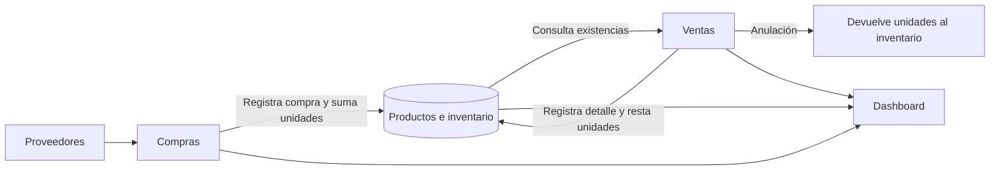
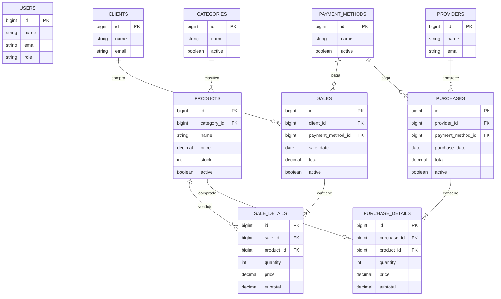

# Sistema de Gestión Empresarial (SGE)


Aplicación web académica para administrar operaciones de una empresa desde una sola plataforma. El sistema reúne catálogo, clientes, proveedores, compras, ventas, métodos de pago y usuarios. Está desarrollado con Laravel y utiliza una base de datos relacional.

> **Importante.**
> Este README describe el código incluido en este repositorio. La sección de alcance diferencia las funciones implementadas de las mejoras propuestas; no se presentan como terminadas las funcionalidades que todavía no están en el código.

---

## Tabla de contenido

- [Sistema de Gestión Empresarial (SGE)](#sistema-de-gestión-empresarial-sge)
  - [Tabla de contenido](#tabla-de-contenido)
  - [Objetivo del sistema](#objetivo-del-sistema)
  - [Funcionalidades implementadas](#funcionalidades-implementadas)
  - [Reglas de operación](#reglas-de-operación)
    - [Ventas](#ventas)
    - [Compras](#compras)
    - [Catálogo y relaciones](#catálogo-y-relaciones)
  - [Roles y acceso](#roles-y-acceso)
  - [Tecnologías](#tecnologías)
  - [Requisitos previos](#requisitos-previos)
  - [Instalación paso a paso](#instalación-paso-a-paso)
    - [1. Clonar el repositorio](#1-clonar-el-repositorio)
    - [2. Instalar dependencias de PHP](#2-instalar-dependencias-de-php)
    - [3. Configurar el entorno](#3-configurar-el-entorno)
    - [4. Iniciar los contenedores](#4-iniciar-los-contenedores)
    - [5. Crear la clave, las tablas y los datos de demostración](#5-crear-la-clave-las-tablas-y-los-datos-de-demostración)
    - [6. Instalar y compilar el frontend](#6-instalar-y-compilar-el-frontend)
    - [7. Abrir la aplicación](#7-abrir-la-aplicación)
  - [Usuarios de demostración](#usuarios-de-demostración)
  - [Uso diario y comandos](#uso-diario-y-comandos)
  - [Estructura del proyecto](#estructura-del-proyecto)
  - [Arquitectura y modelo de datos](#arquitectura-y-modelo-de-datos)
  - [Pruebas](#pruebas)
  - [Alcance actual y mejoras propuestas](#alcance-actual-y-mejoras-propuestas)
  - [Solución de problemas](#solución-de-problemas)

## Objetivo del sistema

El SGE busca centralizar información de inventario y operaciones comerciales. Una venta consulta productos y existencias, registra sus detalles y descuenta las unidades vendidas. Una compra registra los productos adquiridos y aumenta las existencias. El dashboard presenta un resumen operativo para facilitar la consulta diaria.



## Funcionalidades implementadas

| Módulo | Funcionalidad disponible | Implementación |
|---|---|---|
| Acceso | Inicio de sesión, cierre de sesión y administración del perfil | Laravel Breeze |
| Dashboard | Ventas y compras del mes, clientes y productos activos, alertas de stock bajo y últimas ventas | `DashboardController` |
| Productos | Consulta paginada, creación, edición, activación/desactivación y eliminación con validación | `ProductController` |
| Categorías | Consulta, creación, edición, activación/desactivación y eliminación si no tiene productos | `CategoryController` |
| Clientes | Administración de registros de clientes | `ClientController` |
| Proveedores | Administración de registros de proveedores; no permite eliminar los que tienen compras asociadas | `ProviderController` |
| Ventas | Registro de ventas con uno o más productos, cálculo de total, control de stock y consulta de detalle | `SaleController` |
| Anulación de venta | Devuelve al inventario las cantidades registradas en los detalles de la venta | Transacción en `SaleController` |
| Compras | Registro de compra con proveedor, método de pago, productos, cantidades, costo y total | `PurchaseController` |
| Anulación de compra | Descuenta del stock las cantidades de la compra si siguen disponibles | Transacción en `PurchaseController` |
| Métodos de pago | Consulta y mantenimiento de los medios de pago | `PaymentMethodController` |
| Usuarios | Consulta de usuarios y asignación de rol `admin` o `vendedor` | `UserController` |

El dashboard identifica como stock bajo los productos activos con cinco unidades o menos. Sus cifras se calculan a partir de los registros de la base de datos.

## Reglas de operación

### Ventas

- Se debe seleccionar un cliente, un método de pago, una fecha y al menos un producto.
- La cantidad debe ser un entero positivo y el producto no puede repetirse en varias líneas de la misma venta.
- Antes de registrar la operación, el sistema verifica que el stock alcance para cubrir la cantidad solicitada.
- La venta, sus detalles y el descuento de inventario se ejecutan dentro de una transacción. Si falla una validación, no se confirma la operación parcialmente.
- El producto se bloquea durante la validación de existencias para reducir conflictos si hay operaciones simultáneas.
- Al anular una venta, las cantidades de sus detalles se devuelven al inventario y la venta queda marcada como inactiva.

### Compras

- Se debe seleccionar un proveedor, un método de pago, una fecha y al menos un producto.
- La cantidad debe ser positiva, el costo unitario no puede ser negativo y un mismo producto no se repite en varias líneas.
- Al guardar una compra, el stock aumenta inmediatamente por las cantidades registradas.
- La anulación descuenta esas unidades únicamente cuando el inventario todavía tiene suficiente stock; de lo contrario, la operación se rechaza.

> **Nota.**
> En esta versión, la compra se registra como una operación que aumenta el inventario al guardarse. El flujo de órdenes de compra con recepción posterior, parcial o separada todavía no está implementado en este código.

### Catálogo y relaciones

- Los productos requieren una categoría existente y un precio no negativo.
- No se permite eliminar un producto con ventas o compras relacionadas; se puede desactivar desde su formulario.
- No se permite eliminar una categoría que tenga productos asociados ni un proveedor con compras registradas.
- Clientes, proveedores, categorías y productos incluyen un campo de estado activo para controlar su disponibilidad en los formularios.

## Roles y acceso

El campo `users.role` contiene el rol de cada usuario. El middleware propio `role` protege grupos de rutas en el servidor:

| Área | Administrador | Vendedor |
|---|:---:|:---:|
| Dashboard y perfil | Sí | Sí |
| Consulta de productos | Sí | Sí |
| Clientes | Sí | Sí |
| Ventas | Sí | Sí |
| Categorías | Sí | No |
| Creación y edición de productos | Sí | No |
| Proveedores y compras | Sí | No |
| Métodos de pago | Sí | No |
| Administración de usuarios y roles | Sí | No |
| Anulación de ventas | Sí | No |

La tabla resume los grupos definidos en `routes/web.php`. El middleware compara el valor de `users.role` con los roles permitidos y devuelve HTTP 403 si no hay autorización. Esta versión no usa una matriz de permisos por acción ni permite asignar excepciones individuales.

## Tecnologías

| Tecnología | Uso |
|---|---|
| Laravel 13 | Rutas, controladores, modelos, validación, autenticación y migraciones |
| PHP 8.3 o superior | Lenguaje de la aplicación; Sail usa PHP 8.5 en el contenedor configurado |
| MySQL 8.4 | Base de datos en el entorno Docker Compose incluido |
| Laravel Sail y Docker Compose | Ejecución local de Laravel y MySQL |
| Laravel Breeze | Autenticación y perfil de usuario |
| Blade | Plantillas de la interfaz |
| Tailwind CSS y Alpine.js | Estilos e interactividad del frontend |
| Vite y npm | Dependencias y compilación de recursos frontend |
| PHPUnit | Ejecución de pruebas automatizadas |

## Requisitos previos

- Git.
- Docker Desktop con Docker Compose. En Windows, habilitar WSL 2 y la integración de Ubuntu con Docker Desktop.
- Composer y PHP 8.3 o superior para la instalación local de dependencias, o Docker para instalar Composer dentro de un contenedor.
- Node.js y npm, o ejecutar npm por medio de Laravel Sail.

En Windows se recomienda clonar el proyecto dentro del sistema de archivos de Ubuntu, por ejemplo `~/proyecto`, y no dentro de `/mnt/c`, para evitar problemas de rendimiento y permisos con Docker.

## Instalación paso a paso

Los siguientes comandos están pensados para Ubuntu/WSL. Sustituye la URL si clonas desde otro remoto.

### 1. Clonar el repositorio

```bash
mkdir -p ~/proyecto
cd ~/proyecto
git clone https://github.com/monialeja1011/Software-de-Gestion-Empresarial-2026.git sge
cd sge
```

### 2. Instalar dependencias de PHP

Si tienes Composer instalado:

```bash
composer install
```

Si no tienes PHP ni Composer en Ubuntu, puedes instalar las dependencias desde un contenedor de Composer:

```bash
docker run --rm \
  -u "$(id -u):$(id -g)" \
  -v "$(pwd):/var/www/html" \
  -w /var/www/html \
  composer:2 \
  composer install
```

### 3. Configurar el entorno

```bash
cp .env.example .env
```

Para usar el servicio MySQL definido en `compose.yaml`, configura estas variables en `.env`:

```dotenv
APP_NAME="Sistema de Gestión Empresarial"
APP_URL=http://localhost
DB_CONNECTION=mysql
DB_HOST=mysql
DB_PORT=3306
DB_DATABASE=laravel
DB_USERNAME=sail
DB_PASSWORD=password
```

Si el puerto 80 ya está ocupado, agrega `APP_PORT=8080` al `.env`; luego usarás `http://localhost:8080`.

### 4. Iniciar los contenedores

```bash
./vendor/bin/sail up -d
./vendor/bin/sail ps
```

Espera a que MySQL termine de iniciar antes de ejecutar migraciones.

### 5. Crear la clave, las tablas y los datos de demostración

```bash
./vendor/bin/sail artisan key:generate
./vendor/bin/sail artisan migrate --seed
```

`migrate --seed` crea el esquema y ejecuta `DatabaseSeeder`, que registra los usuarios de demostración, los métodos de pago y algunos registros iniciales para probar los módulos.

### 6. Instalar y compilar el frontend

```bash
./vendor/bin/sail npm install
./vendor/bin/sail npm run build
```

### 7. Abrir la aplicación

Visita [http://localhost](http://localhost) o el puerto configurado en `APP_PORT`. Inicia sesión con uno de los [usuarios de demostración](#usuarios-de-demostración).

## Usuarios de demostración

`DatabaseSeeder` crea estas cuentas con la contraseña inicial `password`:

| Correo | Rol |
|---|---|
| `admin@sge.test` | `admin` |
| `vendedor@sge.test` | `vendedor` |

Son credenciales para desarrollo local. No las uses en un entorno público; cambia las contraseñas y revisa la configuración antes de desplegar.

## Uso diario y comandos

```bash
cd ~/proyecto/sge
./vendor/bin/sail up -d      # Iniciar el entorno
./vendor/bin/sail stop       # Detener los contenedores sin borrar datos
./vendor/bin/sail ps         # Consultar el estado de los servicios
```

Durante el desarrollo del frontend puedes ejecutar Vite en modo de actualización automática:

```bash
./vendor/bin/sail npm run dev
```

| Comando | Acción |
|---|---|
| `./vendor/bin/sail artisan migrate` | Ejecuta las migraciones pendientes |
| `./vendor/bin/sail artisan migrate:status` | Consulta el estado de las migraciones |
| `./vendor/bin/sail artisan db:seed` | Carga los datos iniciales de demostración |
| `./vendor/bin/sail artisan route:list` | Lista las rutas registradas |
| `./vendor/bin/sail artisan optimize:clear` | Limpia las cachés de Laravel |
| `./vendor/bin/sail npm run build` | Compila CSS y JavaScript para uso local |
| `./vendor/bin/sail test` | Ejecuta las pruebas automatizadas |
| `./vendor/bin/sail logs -f` | Sigue los registros de los contenedores |

> **Advertencia.**
> `migrate:fresh` elimina todas las tablas antes de crearlas de nuevo. Úsalo solo si aceptas borrar la base de datos local.

## Estructura del proyecto

```text
sge/
├── app/
│   ├── Http/
│   │   ├── Controllers/       # Controladores por módulo
│   │   ├── Middleware/        # Middleware de autorización por rol
│   │   └── Requests/          # Validaciones HTTP
│   └── Models/                # Modelos Eloquent y relaciones
├── bootstrap/                 # Inicialización y registro de middleware
├── config/                    # Configuración de Laravel
├── database/
│   ├── migrations/            # Esquema relacional
│   ├── factories/             # Fábricas para datos de prueba
│   └── seeders/               # Usuarios y datos iniciales
├── resources/
│   ├── css/                   # Estilos Tailwind
│   ├── js/                    # JavaScript y Alpine.js
│   └── views/                 # Vistas Blade por módulo
├── routes/
│   ├── auth.php               # Rutas de autenticación
│   └── web.php                # Rutas web y grupos de rol
├── tests/                     # Pruebas Feature y Unit
└── compose.yaml               # Servicios Laravel y MySQL para Sail
```

## Arquitectura y modelo de datos

La aplicación sigue la estructura MVC de Laravel. Las rutas de `routes/web.php` dirigen las solicitudes a controladores; los controladores validan datos y usan modelos Eloquent para consultar o actualizar MySQL; las vistas Blade presentan los resultados.



Los campos y restricciones definitivos se encuentran en `database/migrations`. El diagrama representa las relaciones principales, no todos los campos auxiliares de Laravel.

## Pruebas

Para ejecutar la suite incluida:

```bash
./vendor/bin/sail test
```

Las pruebas están en `tests/Feature` y `tests/Unit`. El conjunto actual incluye pruebas base de Laravel Breeze; no debe interpretarse como cobertura completa de todos los flujos de inventario, ventas y compras.

## Alcance actual y mejoras propuestas

La versión descrita aquí cuenta con operaciones básicas de catálogo, ventas y compras, además de autorización por los dos roles iniciales. Estas funcionalidades no están implementadas en el código de esta carpeta y, por tanto, requieren desarrollo antes de documentarse como disponibles:

- Permisos configurables por acción y una matriz CRUD administrable.
- Roles adicionales, rol activo y permisos individuales por usuario.
- Órdenes de compra que no alteren inventario hasta registrar una recepción.
- Recepciones parciales, historial de entregas y validación frente al saldo pendiente.
- Cálculo y desglose de IVA por producto en ventas y compras.
- Costo de compra y margen configurables para actualizar automáticamente el precio público.
- Comprobantes PDF de venta y órdenes de compra.
- Auditoría de cambios y kardex de movimientos de inventario.
- Borrado lógico con papelera y restauración.
- Evidencias académicas y documentación de pruebas por requisito.

## Solución de problemas

| Mensaje o síntoma | Causa probable | Qué revisar |
|---|---|---|
| `./vendor/bin/sail: No such file or directory` | No se instalaron las dependencias PHP | Ejecuta `composer install` desde la raíz del proyecto |
| `Cannot connect to the Docker daemon` | Docker Desktop está cerrado o WSL no está integrado | Inicia Docker Desktop y habilita la integración de Ubuntu |
| `Bind for 0.0.0.0:80 failed` | El puerto 80 está ocupado | Define `APP_PORT=8080` en `.env` y reinicia Sail |
| `SQLSTATE[HY000] [2002] Connection refused` | MySQL está iniciando o el host de base de datos no coincide | Espera unos segundos y verifica `DB_HOST=mysql` y `DB_CONNECTION=mysql` |
| `No application encryption key has been specified` | No se generó `APP_KEY` | Ejecuta `./vendor/bin/sail artisan key:generate` |
| `Vite manifest not found` | No se compiló el frontend | Ejecuta `./vendor/bin/sail npm install` y `./vendor/bin/sail npm run build` |
| Respuesta HTTP 403 | El rol del usuario no está autorizado para esa ruta | Comprueba el campo `role` y las restricciones de `routes/web.php` |
| La aplicación conserva una vista o configuración anterior | Caché local desactualizada | Ejecuta `./vendor/bin/sail artisan optimize:clear` y recarga el navegador |

---

<p align="center">
  Proyecto académico · <strong>Sistema de Gestión Empresarial</strong>
</p>
