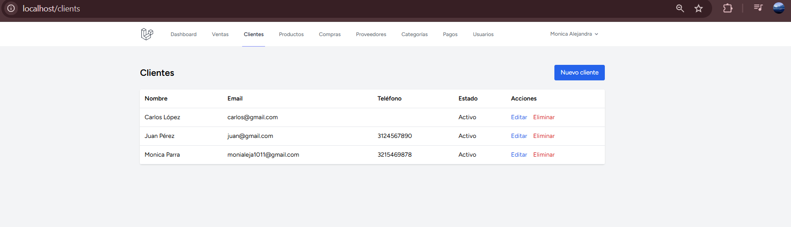
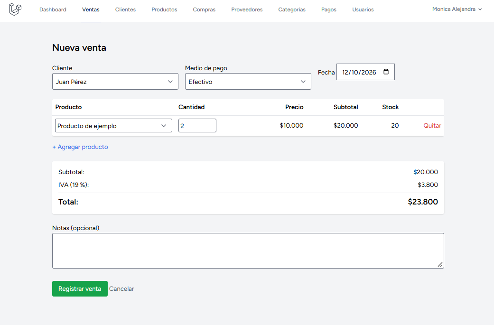
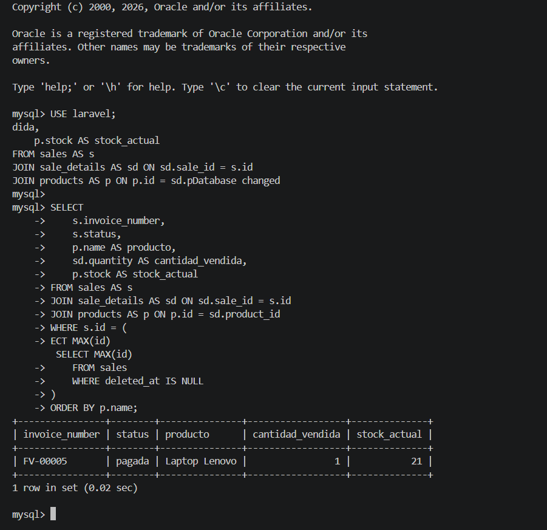
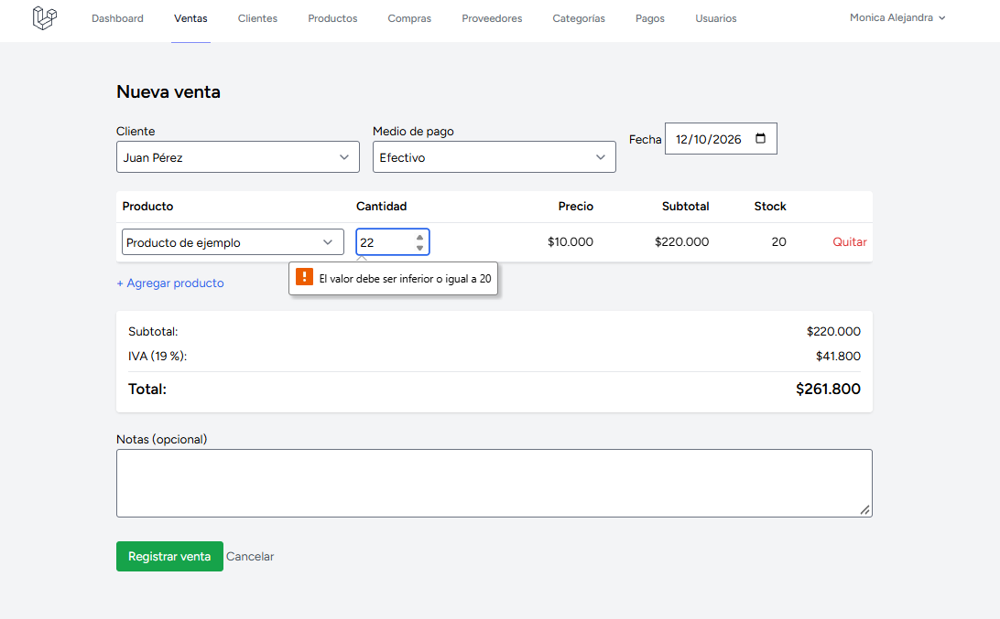
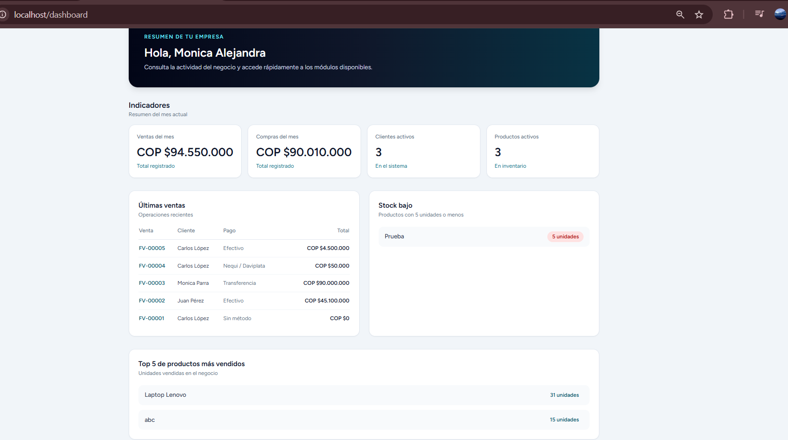
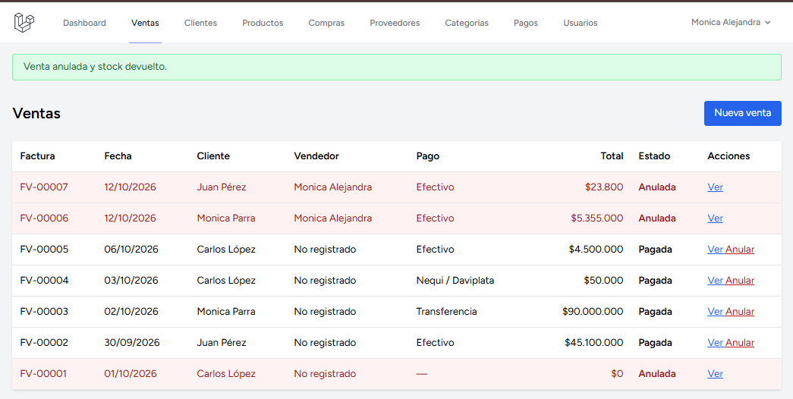

# Sistema de Gestión Empresarial (SGE)

Aplicación web para administrar operaciones empresariales mediante módulos de inventario, ventas, compras y gestión de usuarios. Proyecto académico desarrollado con Laravel, Blade, Tailwind CSS, MySQL y Docker Sail.

## Módulos

- Productos y categorías
- Clientes y proveedores
- Ventas y compras
- Métodos de pago
- Usuarios, roles y permisos
- Dashboard con indicadores

## Roles y permisos

El sistema utiliza Spatie Laravel Permission. Los permisos se asignan a roles y protegen las rutas y las acciones disponibles en las vistas.

Roles de demostración:

- **superadmin:** administración de roles y permisos del sistema.
- **admin:** administración de la operación.
- **vendedor:** acceso a las funciones comerciales autorizadas.
- **almacenista:** consulta y gestión autorizada de productos, categorías y compras.

Las cuentas de demostración usan la contraseña `password`. Son únicamente para desarrollo local y deben cambiarse antes de usar el sistema en un entorno real.

| Correo | Rol |
| --- | --- |
| `superadmin@sge.test` | superadmin |
| `admin@sge.test` | admin |
| `vendedor@sge.test` | vendedor |
| `almacenista@sge.test` | almacenista |

## CRUD de productos y categorías

Los listados incluyen búsqueda, filtros y paginación. Las validaciones de creación y edición se gestionan mediante Form Requests. Productos y categorías usan eliminación lógica: los registros enviados a la papelera se pueden restaurar.

Las rutas comprueban permisos en el servidor. Las vistas también ocultan los enlaces y botones que el usuario no puede utilizar.

## Requisitos para desarrollo local

- Docker y Docker Compose
- PHP y Composer para instalar las dependencias
- Node.js y npm

## Instalación con Laravel Sail

Desde la carpeta del proyecto:

```bash
composer install
cp .env.example .env
./vendor/bin/sail up -d
./vendor/bin/sail artisan key:generate
./vendor/bin/sail artisan migrate --seed
./vendor/bin/sail npm install
./vendor/bin/sail npm run build
```

Para iniciar el entorno en otra ocasión:

```bash
./vendor/bin/sail up -d
```

La aplicación queda disponible en:

```text
http://localhost
```

Para compilar los estilos automáticamente durante el desarrollo:

```bash
./vendor/bin/sail npm run dev
```

## Evidencias de la Clase 8

Las capturas de roles, permisos, filtros, eliminación lógica y autorización se guardan en:

```text
docs/evidencias/clase8/
```

## Entrega de la clase 9

Se implementó el registro y la anulación de ventas con control de inventario, cálculo de subtotal, IVA y total, y un dashboard con indicadores y Top 5.

### Evidencias

1. **Módulo de clientes**

   

2. **Nueva venta con productos y totales**

   

3. **Venta, detalles y stock en MySQL**

   

4. **Intento de venta sin stock suficiente**

   

5. **Dashboard con KPIs y Top 5**

   

6. **Anulación de venta y devolución de stock**

   

### Repositorio

[Software de Gestión Empresarial 2026 en GitHub](https://github.com/monialeja1011/Software-de-Gestion-Empresarial-2026)
